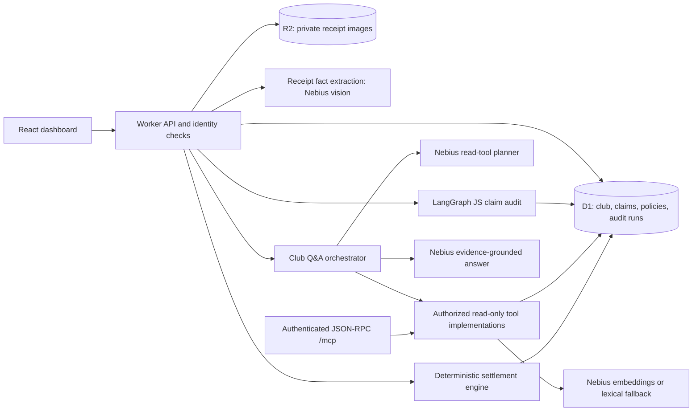

# AI / Agentic AI implementation guide

This guide describes the **hosted Eagles Financial Audit Site as implemented**, not the separate local Python/PostgreSQL prototype. The live app is a React UI and Worker API in one deployment, backed by Cloudflare D1 (records) and R2 (private receipt images). Nebius Token Factory supplies chat/vision and embeddings when configured. The actual model IDs are runtime configuration, displayed after sign-in on the **AI / Agentic AI** tab; they are not hard-coded in the repository.

The useful distinction for a project demo is this: **claim auditing uses a real LangGraph JS state graph; Club Q&A uses a bounded LLM tool planner and grounded answer generator, not a second LangGraph graph.** The two workflows share policy and club data, but no autonomous peer agents communicate with each other.

## Architecture at a glance



ChatGPT Site identity is mapped to an app actor (`admin`, `treasurer`, or `player`). Server-side role, roster, team-season, and claim-ownership checks apply before sensitive operations. An MCP client receives only data that the signed-in actor is permitted to read; MCP tools cannot submit or approve expenses. See [`actorFor()` and access checks](lib/data.ts) and the [API routes](app/api/%5B...path%5D/route.ts).

## Business workflow → implementation

| Business workflow | What happens | AI/agentic part | Durable result / human control |
| --- | --- | --- | --- |
| Club setup and synthetic data | Admin seeds Eagles-LCCL/WMCL Spring and Fall 2026, rosters, 10 completed matches per team-season, league/umpire fees, and synthetic policies. Admin can configure teams, players, attendance, fees, and multipliers. | None; seeded/configured data is deterministic. | D1 records; fee edits are versioned in `config_history`. |
| Claim submission | A rostered player submits a season-level claim; they may have played zero games. A PNG/JPEG receipt is optional. The UI combines claim creation, optional upload/extraction, and audit under one submit action. | Nebius vision extracts receipt facts when an image is attached. LangGraph audits the claim. | Claim, findings, citations, route, and audit run in D1; image bytes in R2. |
| Re-audit | A pending claim can be re-audited after adding/replacing a receipt. | Same LangGraph path, with live stage events. | Updated route and another D1 audit-run record. Final approved/rejected claims are not re-audited. |
| Treasurer review and clarification | Flagged claims wait for an authorized treasurer/admin to approve, reject, or request clarification with a reason. A claimant can resubmit a revised claim after clarification. | The graph only chooses the *handoff route*; it does not impersonate the treasurer or decide a human review. | Decision, approved amount, revision snapshots, and audit-run stage persist in D1. |
| Club Q&A | Member asks about policy, teams, roster, pool, or settlement. | Nebius selects up to three allowlisted read tools; retrieval and grounded answer generation follow. | Answer, tool choice, retrieval method, and section IDs are shown for the current run; no financial record is changed. |
| MCP playground / external client | Authenticated JSON-RPC client calls an advertised read-only tool. | Tool interface for agents, not an autonomous second agent. Answer tools may invoke the Q&A model. | Authorized read-only response; no write tool is exposed. |
| Weighted settlement | League fee + umpire fees for completed games + approved player-paid claims form the team-season pool. Allocate by games played × configured multiplier, then apply approved payer credits. | None; integer-cent TypeScript calculation. | Provisional preview; treasurer/admin can finalize only after the claim deadline and all claims are resolved. |

The seed and fixture provenance are in [`docs/datasets.md`](docs/datasets.md). Synthetic policies are product assumptions, **not** an official league policy or real-world accounting advice.

## Claim audit: actual LangGraph path

The UI first saves a claim, optionally uploads an image and calls receipt extraction, then streams the audit. Those intake actions are **outside** the graph. The server performs `claim_lookup` and `duplicate_check` before invoking the graph. A duplicate is a matching team-season, payer, amount, vendor, and expense date from another **non-rejected** claim. It is a review flag, not an automatic rejection. This differs from receipt verification, which compares the submitted claim to facts extracted from *its own image*.

```text
claim_save [UI/API]
  → receipt_extraction [optional PNG/JPEG vision, API]
  → claim_lookup → duplicate_check [audit service]
  → evaluate_rules → verify_receipt → route_review → retrieve_policy [LangGraph]
  → auto_approve OR handoff_to_treasurer [LangGraph conditional edge]
  → persist_decision [audit service]
```

The graph's state contains the claim, duplicate flag, extraction result, rule result, and visited nodes. [`evaluate_rules`](lib/audit-graph.ts) applies the deterministic receipt, alcohol, amount, payer, and duplicate rules. `verify_receipt` checks extraction completeness and compares receipt total, vendor, date, and alcohol indication to the form. `route_review` forces review for findings. `retrieve_policy` checks that cited policy section IDs exist in D1; **this node is not vector search**. The conditional edge selects auto-approval or treasurer handoff. [`executeClaimAudit()`](lib/claim-audit-service.ts) streams node completions and persists the route, findings, citations, and audit run. [`/api/claims/[id]/audit/stream`](app/api/claims/%5Bid%5D/audit/stream/route.ts) supplies the live UI tracker.

The under-`$50.00` threshold means *strictly below* $50 can auto-approve **only if** there is a readable, matching receipt, claimant equals payer, no alcohol, no suspected duplicate, and no other finding. Exactly $50 needs review. A missing, unclear, or mismatched receipt also needs review; an optional receipt is not equivalent to automatic approval. The model extracts facts but cannot override these rules. New PDF receipts are not accepted; historical PDFs, if any, are review-only. The API accepts PNG/JPEG files under 5 MB and checks file signatures as well as MIME type. See [`extractReceipt()`](lib/ai.ts), [`evaluateClaim()`](lib/data.ts), and the [claim API](app/api/%5B...path%5D/route.ts).

An `APPROVED` claim contributes its approved amount to the pool and credits the payer after each player's weighted charge is calculated. `NEEDS_REVIEW`, `NEEDS_CLARIFICATION`, `REJECTED`, and other unresolved claims do not enter the pool. A claimant may submit if rostered even with zero games played; season claim windows close three months after the last completed game, using the club's `America/New_York` calendar date.

## Club Q&A: tool planning, retrieval, grounded answer

The [Club Q&A streaming endpoint](app/api/policy/stream/route.ts) runs [`runClubQuestion()`](lib/club-qa.ts):

1. **Planner:** Nebius proposes 1–3 tool names from a strict read-only allowlist. Invalid or unavailable planning falls back to bounded keyword rules. It cannot choose a write tool.
2. **Authorized tool calls:** The server selects an authorized team-season and invokes the same read-tool implementations that the MCP server exposes. No matching authorized team means a tool is skipped, not a broad cross-team query.
3. **Policy retrieval, when selected:** [`policySearch()`](lib/data.ts) reads versioned policy sections from D1, embeds the question and uncached sections through Nebius, ranks by cosine similarity, and returns up to five sections with IDs and metadata. Intent anchors help approval/limit questions. If embeddings fail or are unconfigured, keyword ranking is used. This is **vector ranking with lexical fallback**, not a Pinecone index or a continuously fused hybrid search.
4. **Grounded answer:** Nebius receives only returned evidence. Policy-only answers must cite returned section IDs; mixed club answers must cite returned policy IDs or `MCP:tool_name` labels. Unsupported citation labels are rejected. Mixed answers also reject dollar amounts not present in evidence. If evidence or a verified model answer is unavailable, the UI reports a labeled fallback and leaves the evidence visible instead of inventing a policy or balance.

The live tracker shows `planner`, `tool_<name>`, `retrieval` (with method and policy section IDs), and `model` status. `MODEL_OUTPUT_BUDGET_EXHAUSTED` means the provider ended generation before yielding usable answer text; it is a model fallback, **not** a successful AI answer. This Q&A workflow is a bounded orchestrator written in TypeScript, not a LangGraph graph. See [`lib/club-qa.ts`](lib/club-qa.ts) and [model prompts/guards](lib/ai.ts).

## MCP tool catalog

The authenticated JSON-RPC MCP endpoint is [`/mcp`](app/mcp/route.ts); the in-app playground calls the equivalent [`/api/mcp`](app/api/mcp/route.ts). Both advertise these eight tools from [`lib/mcp-tools.ts`](lib/mcp-tools.ts):

| Tool | Business use |
| --- | --- |
| `list_team_seasons` | Visible teams, seasons, and configured fees. |
| `get_team_overview` | Authorized pools, claim counts, and roster counts. |
| `get_team_settlement` | Calculated, access-filtered player charges, credits, and balances for one team-season. |
| `get_team_roster` | Roster names and games played for one authorized team-season; no emails. |
| `search_policy_sections` | Ranked policy text with section IDs and retrieval metadata. |
| `list_policy_sections` | Versioned synthetic policy library. |
| `answer_policy_question` | Policy-only retrieval and citation-checked model answer. |
| `answer_club_question` | Bounded tool selection and answer across club data and policy. |

The browser's live Club Q&A endpoint calls the **same server-side read-tool functions** but is not itself MCP transport. The playground performs a real `tools/call` JSON-RPC request. MCP here means a standard tool interface; it does **not** demonstrate agent-to-agent (A2A) messaging. Claim writes, configuration changes, and treasurer decisions remain separately authorized application API calls.

## Models, state, memory, and guardrails

| Concern | Hosted implementation | Boundary |
| --- | --- | --- |
| Chat and receipt vision | Nebius `/v1/chat/completions`, selected by runtime `NEBIUS_MODEL`; same configured model handles Q&A/planning and image fact extraction. | No secret or model ID is committed; the signed-in technology page reports the current ID. Receipt output is treated as untrusted evidence. |
| Embeddings | Nebius `/v1/embeddings`, selected by `NEBIUS_EMBEDDING_MODEL`. | Policy vectors are cached in a Worker-isolate `Map` keyed by model and policy content/version. The cache can disappear; it is not durable vector storage. |
| LangGraph state | Per-audit transient graph state and streamed node updates. | D1 audit runs persist *business* history, but there is no durable LangGraph checkpoint saver or graph resume after a Worker restart. Human review continues through app/D1 state. |
| Application memory | D1 stores actors, team-seasons, attendance, policies, claims, decisions, revisions, configuration history, and settlements; R2 stores private receipt bytes. | No mem0, long-term conversational memory, autonomous learning, or agent-to-agent state exchange is implemented. |
| Safety and authorization | Server-side actor/roster checks, read-only MCP tools, deterministic approval rules, citation verification, amount guard for mixed answers, explicit failure labels. | LLM output is not trusted to approve claims, alter fees, calculate settlements, or bypass access controls. |
| Observability | Live NDJSON progress for claim audits and Club Q&A; D1 audit-run records for claim routes and review state. | The browser trace is for the current execution, not a durable replay of every model/tool event. LangSmith tracing is not configured in this hosted source. |

The app does not use PostgreSQL, Pinecone, Fireworks, LlamaIndex, or a separate A2A service in the hosted deployment. Those tools were considered during planning; naming them as implemented would overstate the prototype. D1/R2 are the hosted sources of truth. Financial math lives in [`lib/finance.ts`](lib/finance.ts), where integer-cent allocation uses the largest-remainder method and a player-ID tie-breaker. Default multipliers are 0 games → 0, 1 → 0.5, 2–3 → 0.75, 4–6 → 1, and 7–10 → 1.25; admins may edit per-game-count multipliers for an open team-season.

## Suggested evaluator walkthrough

1. On **AI / Agentic AI**, show the runtime model IDs and business/tech map. State the distinction between the LangGraph audit and bounded Q&A orchestrator.
2. Submit a small, same-payer claim with a clear PNG/JPEG receipt. Read the live `claim_save` → `receipt_extraction` → audit-node → `persist_decision` tracker. Show extracted facts versus entered amount/vendor/date and the final route. A clean under-$50 claim may auto-approve; a receipt or model failure appropriately routes to review.
3. Submit an alcohol, different-payer, missing-receipt, or $50 claim to trigger `handoff_to_treasurer`. Show a human decision with a reason and the resulting settlement preview; optionally re-audit an unresolved claim after replacing its receipt.
4. Ask Club Q&A “Who approves expenses, and is there a maximum claim amount?” Show planner choice, named read tool, retrieval method, exact policy section IDs, and citation-checked answer or explicit fallback.
5. In the MCP playground, call `get_team_settlement` or `search_policy_sections` and point out the real JSON-RPC request/response. Explain that MCP exposes read tools; the browser Q&A progress route shares their implementation but is not the MCP protocol.
6. Show weighted charges and approved payer credits. Explain that this final calculation is deterministic, not LLM-generated.

For local setup, tests, hosted access, and submission boundaries, see the [main README](README.md). The prototype is educational and synthetic; it does not move money or replace an audited accounting system.
